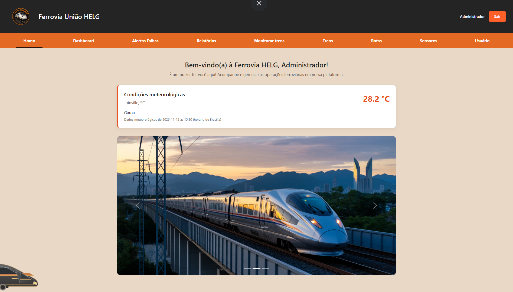
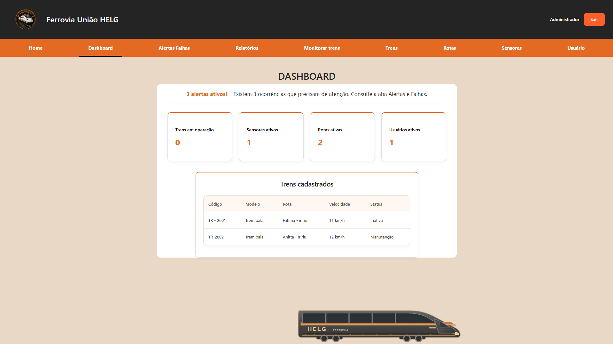
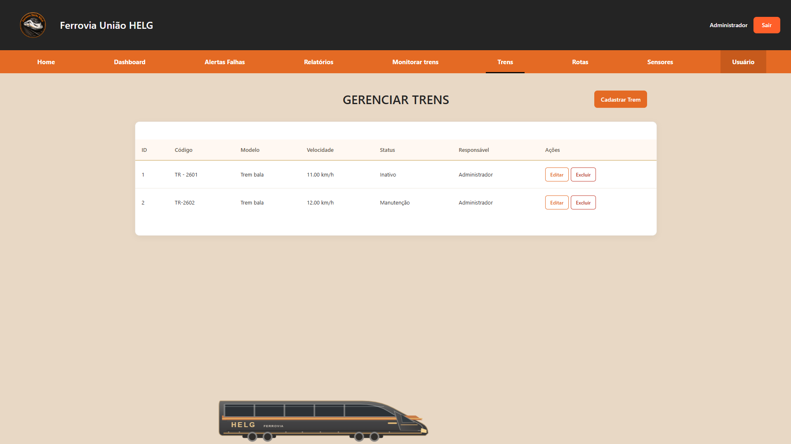
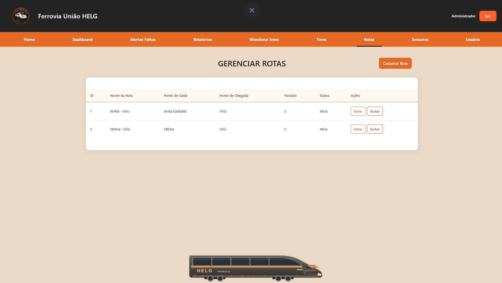
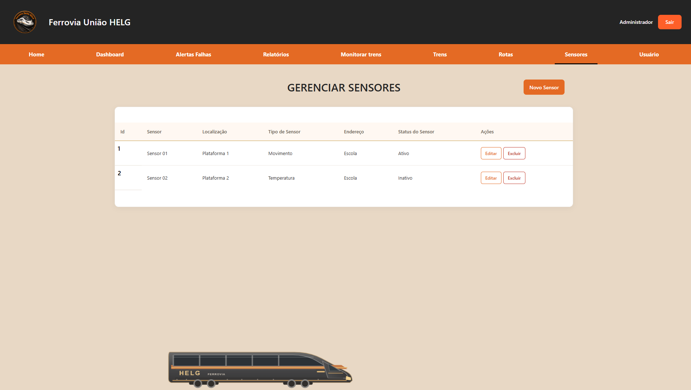
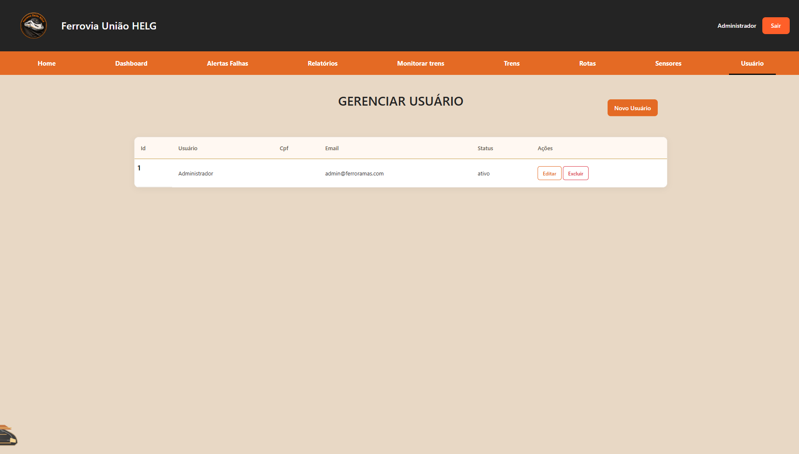
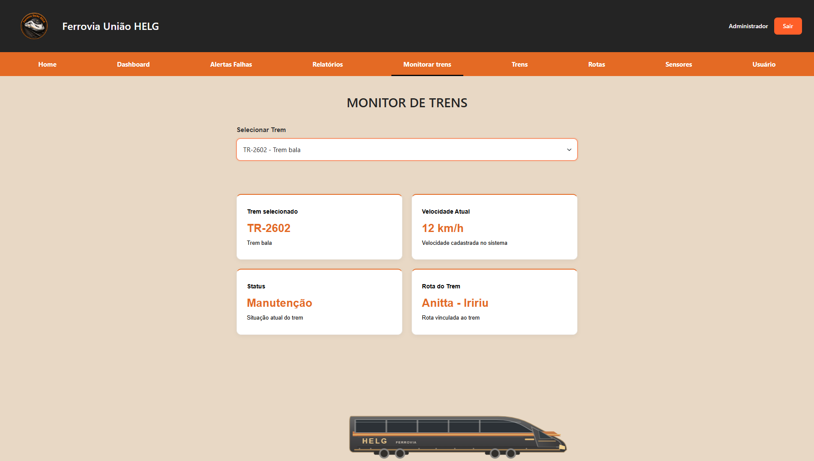
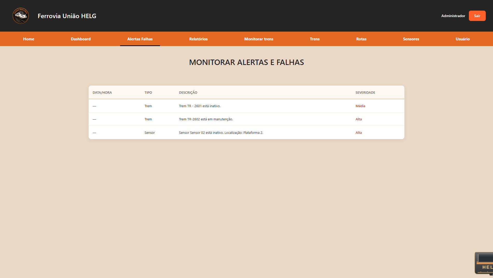
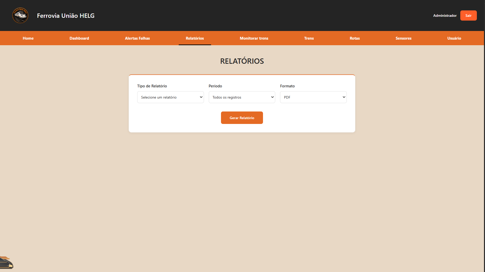
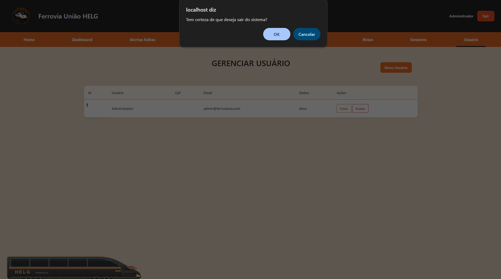

# Manual de Utilização — Ferrovia HELG

Este manual apresenta as principais funcionalidades da Ferrovia HELG e explica como utilizar o sistema.

## 1. Acesso ao sistema

Ao acessar a Ferrovia HELG, o usuário encontra a página inicial, com informações sobre o projeto e a opção de realizar login.

Após informar o e-mail e a senha, o sistema libera as funcionalidades de acordo com o perfil de acesso.

O sistema possui dois perfis:

- **Administrador:** pode gerenciar usuários, trens, rotas e sensores.
- **Usuário comum:** possui acesso às funcionalidades permitidas para seu perfil.

## 2. Home

A Home apresenta as informações iniciais da Ferrovia HELG, incluindo o carrossel de imagens e informações meteorológicas.

## 3. Dashboard

O dashboard apresenta indicadores gerais sobre as operações ferroviárias, facilitando a consulta das informações do sistema.

## 4. Gerenciamento de trens

Na área de gerenciamento de trens, é possível cadastrar, consultar, editar e excluir trens.

Também é possível associar um usuário responsável a cada trem.

As operações de exclusão respeitam os relacionamentos existentes no sistema.

## 5. Gerenciamento de rotas

A área de rotas permite cadastrar, consultar, editar e excluir rotas, além de associá-las aos trens cadastrados.

## 6. Gerenciamento de sensores

Nesta área, é possível cadastrar, consultar, editar e excluir sensores, além de visualizar suas informações e seus estados.

## 7. Gerenciamento de usuários

O gerenciamento de usuários permite realizar cadastros, consultas, alterações e exclusões, conforme as permissões do administrador.

No cadastro, o sistema utiliza a API ViaCEP para auxiliar no preenchimento do endereço.

## 8. Monitoramento de trens

A área de monitoramento permite acompanhar a simulação das rotas dos trens e visualizar informações sobre seu deslocamento.

## 9. Alertas e falhas

Esta área apresenta os alertas registrados no sistema, permitindo consultar informações sobre ocorrências e falhas.

## 10. Relatórios

A área de relatórios permite consultar informações operacionais e gerar relatórios com os dados disponíveis no sistema.

## 11. Encerramento da sessão

Para sair do sistema, clique no botão **Sair**, localizado no cabeçalho.

O sistema solicitará uma confirmação antes de encerrar a sessão e retornar à página de login.

---

**Ferrovia HELG — Sistema de Gerenciamento e Monitoramento Ferroviário**

Projeto desenvolvido durante o curso técnico em Desenvolvimento de Sistemas.
