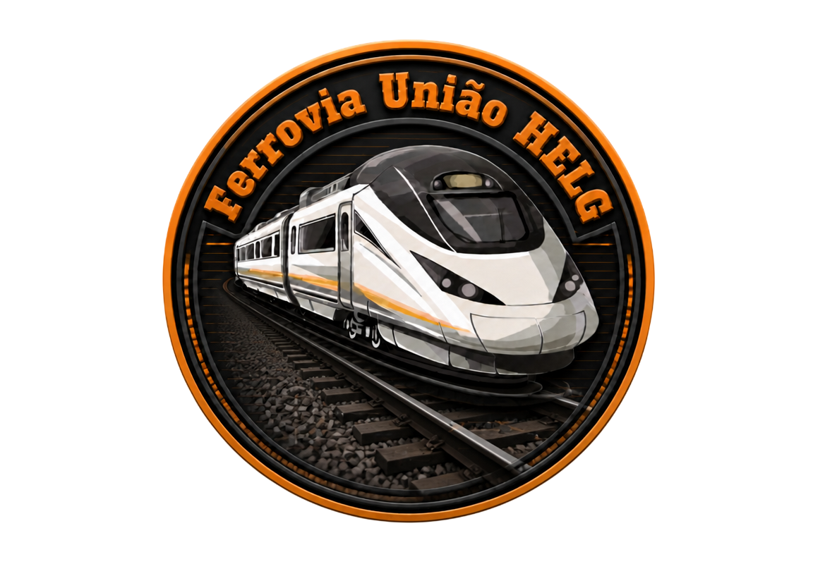
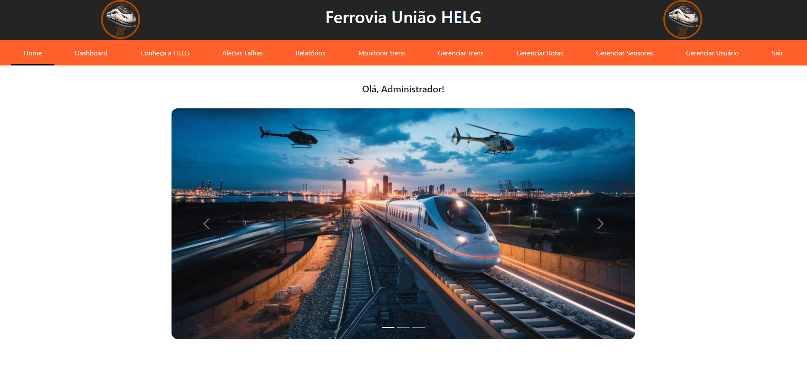
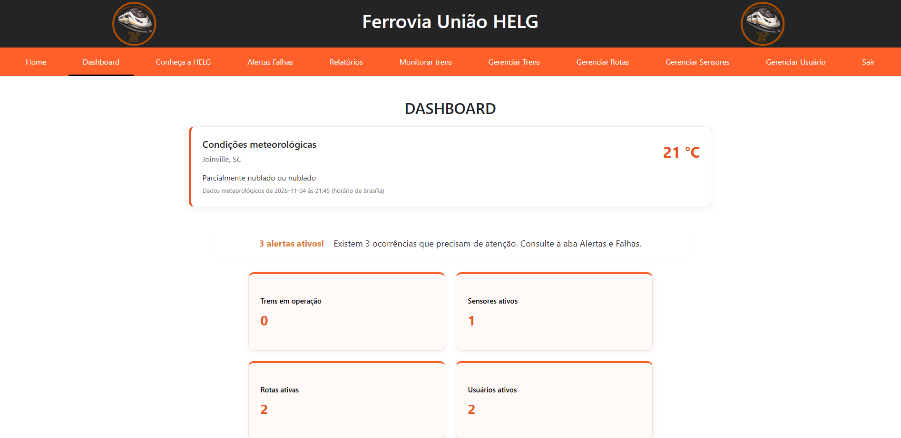
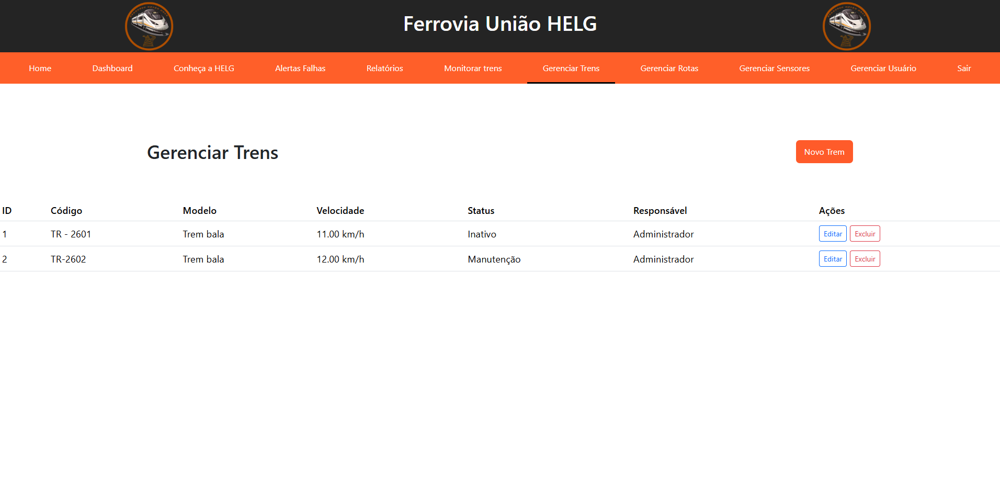
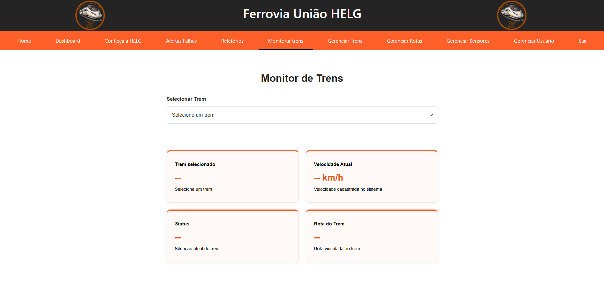

Ferrovia União HELG
Sistema de Gerenciamento e Monitoramento Ferroviário
Projeto da Situação de Aprendizagem Ferrorama

Sobre o projeto
A Ferrovia HELG é um projeto de desenvolvimento de sistemas voltado ao gerenciamento e monitoramento ferroviário. Reúne informações sobre usuários, trens, rotas e sensores, além de indicadores, alertas e relatórios.

A ideia é facilitar o acompanhamento das operações e organizar os cadastros em um só sistema.
Objetivos
- Organizar o cadastro e o gerenciamento de usuários, trens, rotas e sensores.
- Permitir a consulta de informações operacionais.
- Apresentar indicadores e relatórios em uma interface centralizada.
- Disponibilizar recursos de acompanhamento e simulação de rotas.
- Aplicar conceitos de banco de dados, desenvolvimento web, autenticação e IoT.
Funcionalidades
Área	Funcionalidade
Autenticação	Login, logout e controle de sessão.
Perfis	Diferenciação entre administrador e usuário comum, com restrições de acesso.
Usuários	Cadastro, consulta, edição e exclusão, respeitando as regras do sistema.
Trens	Cadastro, consulta, edição, exclusão e associação com um responsável.
Rotas	Cadastro, consulta, edição e gerenciamento de rotas associadas aos trens.
Sensores	Cadastro, consulta, edição e gerenciamento de sensores.
Dashboard	Visualização de indicadores e informações gerais da operação.
Monitoramento	Tela de acompanhamento e simulação de trajetos de trens.
Alertas e falhas	Consulta de ocorrências registradas no sistema.
Relatórios	Consulta e geração de informações operacionais.
Página de apresentação	Área Conheça HELG, acessível antes do login.

Perfis de acesso
O sistema possui dois perfis de usuário:
- Administrador: acesso às funcionalidades administrativas de gerenciamento, conforme as permissões implementadas.
- Usuário comum: acesso às funcionalidades autorizadas para seu perfil.
As permissões são verificadas no sistema para impedir operações não autorizadas.
Integrações
- ViaCEP: preenchimento automático de informações de endereço durante o cadastro de usuários.
- API de clima: apresentação de informações meteorológicas na página principal.
Tecnologias utilizadas
Tecnologia	Utilização
HTML5	Estrutura das páginas.
CSS3	Estilização e identidade visual.
JavaScript	Interações e funcionalidades no navegador.
PHP	Processamento das operações no servidor.
MySQL	Armazenamento dos dados.
XAMPP	Ambiente local com Apache e MySQL.
Git e GitHub	Versionamento e colaboração.
Scrum e Kanban	Organização das atividades da equipe.

Estrutura do projeto
sa-ferrorama/
├── assets/           # Imagens e estilos
├── backend/          # Processamento das operações
├── db/               # Banco de dados SQL
├── infra/            # Conexão e verificações de acesso
├── public/           # Páginas do sistema
├── script/           # Arquivos JavaScript
├── index.php         # Interface principal
└── readme.md         # Documentação do projeto
Como executar o projeto
Requisitos: XAMPP com Apache, PHP e MySQL, navegador e Git (para clonar o repositório).
1. Instale o XAMPP e inicie os serviços Apache e MySQL.
2. Na pasta htdocs do XAMPP, clone o repositório:
   git clone https://github.com/EduardoLopes17/sa-ferrorama.git
3. Acesse o phpMyAdmin e importe o arquivo db/ferroramas.sql. Confira o nome do banco definido no arquivo SQL.
4. Verifique as configurações de conexão no arquivo infra/conexao.php, especialmente usuário, senha e porta do MySQL. No ambiente utilizado pela equipe, a porta padrão é 3306.
5. Abra o projeto no navegador. Se a pasta clonada estiver com o nome sa-ferrorama, utilize:
   http://localhost/sa-ferrorama/public/conheca_helg.php
6. Acesse a tela de login e utilize uma conta de demonstração previamente cadastrada no banco de dados.
Observação: não publique credenciais reais de acesso ou senhas do banco no repositório.
Capturas de tela

Página inicial

Dashboard

Gerenciamento de trens

Monitoramento

Requisitos Funcionais
RF1 - O sistema deve permitir login com nome de usuário e senha, bloqueando o acesso em caso de credenciais inválidas. 

RF2 - O sistema deve disponibilizar ao Adm a tela de cadastro com os campos: nome completo, CPF, telefone, e-mail, endereço, cidade, estado, senha e confirmação de senha. 

RF3 - O sistema deve permitir navegação entre as telas de login e cadastro por meio de links contextuais. 

RF4 - O sistema deve exibir modal de confirmação ao acionar "Sair", encerrando a sessão e redirecionando ao login somente após confirmação do usuário. 

RF5 - O sistema deve exibir painel com os indicadores: total de trens ativos, sensores online, taxa de sucesso operacional e tempo médio de viagem.  

RF6 - O sistema deve listar os trens em operação com ID, rota, status, velocidade atual e próxima parada estimada. 

RF7 - O sistema deve exibir banner de alertas ativos no topo do dashboard, com contagem e descrição sumária das ocorrências. 

RF8 - O sistema deve permitir cadastrar novos sensores informando ID, localização e tipo do sensor. 

RF9 - O sistema deve exibir na mesma tela a lista de sensores já cadastrados com ID, localização e tipo. 

RF10 - O sistema deve listar todos os sensores com as colunas ID, localização, tipo e status, diferenciando visualmente Ativo (verde) de Inativo (vermelho).  

RF11 - O sistema deve permitir alterar o status de um sensor entre Ativo e Inativo diretamente na tela de gerenciamento.  

RF12 - O sistema deve exibir painel detalhado do trem selecionado com: ID, rota, velocidade atual, velocidade média, status e próxima parada com tempo estimado.  

RF13 - O sistema deve indicar explicitamente quando o trem está sem atrasos ou com atraso registrado, com destaque visual diferenciado para cada situação.  

RF14 - O sistema deve registrar e exibir alertas com data/hora, tipo (sensor, trem ou sistema), descrição e nível de severidade. 

RF15 - O sistema deve classificar alertas em três níveis de severidade — Alta, Média e Baixa — com diferenciação visual por cor em cada linha da listagem.  

RF16 - O sistema deve exibir os alertas em ordem cronológica decrescente, com os eventos mais recentes no topo da listagem.  

RF17 - O sistema deve permitir gerar relatórios configuráveis por tipo, período e formato de saída. 

RF18 - O sistema deve listar os relatórios gerados recentemente com nome e data de geração.  

RF19 - O sistema deve suportar ao menos o formato PDF como saída disponível para geração de relatórios. 

RF20 - O sistema deve disponibilizar barra de navegação persistente em todas as telas internas, com acesso a todos os módulos e à opção de sair, além do logotipo da empresa no cabeçalho. 
Requisitos Não Funcionais
RN1 - A interface deve ser intuitiva, com nomenclatura em português brasileiro e feedback visual claro para ações do usuário. 

RN2 - As senhas devem ser armazenadas de forma criptografada. A sessão deve ser encerrada de forma segura ao clicar em "Sair". 

RN3 - O sistema deve estar disponível 24/7, dado que o monitoramento ferroviário é contínuo e crítico. 

RN4 - O dashboard deve atualizar os dados dos trens e sensores em tempo próximo ao real, com latência máxima tolerável de 30 segundos. 

RN5 - A interface deve se adaptar a diferentes resoluções de tela sem perda de funcionalidade. 

RN6 - O código deve ser modular por tela/módulo para facilitar evolução e manutenção independente de cada seção. 

RN7 - A identidade da marca deve ser mantida em todas as telas. 

RN8 - Todos os alertas gerados devem ser armazenados com registro de data/hora para fins de auditoria.
Metodologia de desenvolvimento
A equipe utilizou Scrum e Kanban para organizar as etapas do projeto. As atividades foram acompanhadas pelo GitHub Projects, e as alterações no código foram registradas por commits no repositório.
Equipe de desenvolvimento
- Eduardo Lopes
- Guilherme Floriano
- Hugo Gramme
- Luis Gustavo
Projeto desenvolvido em equipe no curso técnico em Desenvolvimento de Sistemas.
Repositório
GitHub — Ferrovia HELG (SA Ferrorama)

Ferrovia União HELG
Sistema de Gerenciamento e Monitoramento Ferroviário

